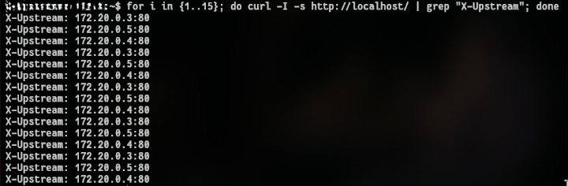

# Configuração do WordPress com Múltiplas Instâncias Utilizando Nginx e Docker Compose

> **Disciplina:** Computação Distribuída  
> **Professor:** Prof. Nabor  
> **Trabalho 2:** Balanceamento de Carga HTTP e Escalabilidade Horizontal  

---

## 1. Introdução e Objetivo

O objetivo deste trabalho é implementar uma arquitetura web distribuída de alta disponibilidade e escalabilidade horizontal para a aplicação WordPress. A infraestrutura é orquestrada utilizando o **Docker Compose** e conta com um servidor **Nginx** atuando como balanceador de carga HTTP (*Load Balancer*) e proxy reverso à frente de três instâncias de backend do WordPress, compartilhando uma única instância do banco de dados relacional **MySQL**.

---

## 2. Arquitetura do Sistema

A solução é composta por 5 contêineres interconectados através da rede em ponte (*bridge network*) do Docker:

```text
Actor ──► nginx ──┬──► wordpress1 ──┬──► mysql
                  ├──► wordpress2 ──┤
                  └──► wordpress3 ──┘
```

### Componentes:

1. **Nginx (`nginx:1.19.0`):**
   - Atua como o ponto único de entrada (*Single Point of Entry*).
   - É o **único** serviço que expõe porta para o host (`80:80`).
   - Distribui o tráfego de entrada entre as instâncias de aplicação utilizando o algoritmo **Round-Robin**.
   - Adiciona o cabeçalho HTTP de resposta `X-Upstream` contendo o IP e porta do contêiner do WordPress que processou a requisição.
   - Mapeia o volume de arquivos estáticos em `/usr/share/nginx/html`.

2. **Instâncias WordPress (`wordpress:5.4.2-php7.2-apache`):**
   - Três contêineres idênticos: `wordpress1`, `wordpress2` e `wordpress3`.
   - **Sem portas mapeadas na máquina hospedeira:** a comunicação é puramente interna através da rede do Docker, impedindo acessos externos diretos.
   - Compartilham entre si e com a máquina hospedeira o diretório `/var/www/html` via *bind mount* (`./html`), garantindo que uploads, temas e arquivos PHP permaneçam idênticos em todas as instâncias.

3. **Banco de Dados Centralizado (`mysql:5.7`):**
   - Mantém as tabelas relacionais do WordPress.
   - **Sem porta exposta para a máquina hospedeira**, acessível exclusivamente pelos nós da rede interna.
   - Dados persistidos no diretório local `./db_data`.

---

## 3. Especificação dos Arquivos de Configuração

### 3.1. `nginx.conf`

Configuração de proxy reverso e pool upstream:

```nginx
events { worker_connections 1024; }

http {
    upstream wordpress { # pool de servidores de backend
        server wordpress1;
        server wordpress2;
        server wordpress3;
    }

    server {
        listen 80 default_server;
        listen [::]:80 default_server;

        root /usr/share/nginx/html;
        index index.php;

        location / {
            add_header X-Upstream $upstream_addr;
            proxy_set_header Host $host;
            proxy_set_header X-Real-IP $remote_addr;
            proxy_set_header x-forwarded-for $proxy_add_x_forwarded_for;
            proxy_pass http://wordpress;
        }
    }
}
```

### 3.2. `docker-compose.yml`

Declaração dos serviços, limites de exposição de rede, volumes e dependências:

```yaml
services:
  mysql:
    image: mysql:5.7
    container_name: mysql
    restart: always
    environment:
      MYSQL_ROOT_PASSWORD: rootpassword
      MYSQL_DATABASE: wordpress
      MYSQL_USER: wordpress
      MYSQL_PASSWORD: wordpresspassword
    volumes:
      - ./db_data:/var/lib/mysql

  wordpress1:
    image: wordpress:5.4.2-php7.2-apache
    container_name: wordpress1
    restart: always
    depends_on:
      - mysql
    environment:
      WORDPRESS_DB_HOST: mysql:3306
      WORDPRESS_DB_USER: wordpress
      WORDPRESS_DB_PASSWORD: wordpresspassword
      WORDPRESS_DB_NAME: wordpress
    volumes:
      - ./html:/var/www/html

  wordpress2:
    image: wordpress:5.4.2-php7.2-apache
    container_name: wordpress2
    restart: always
    depends_on:
      - mysql
    environment:
      WORDPRESS_DB_HOST: mysql:3306
      WORDPRESS_DB_USER: wordpress
      WORDPRESS_DB_PASSWORD: wordpresspassword
      WORDPRESS_DB_NAME: wordpress
    volumes:
      - ./html:/var/www/html

  wordpress3:
    image: wordpress:5.4.2-php7.2-apache
    container_name: wordpress3
    restart: always
    depends_on:
      - mysql
    environment:
      WORDPRESS_DB_HOST: mysql:3306
      WORDPRESS_DB_USER: wordpress
      WORDPRESS_DB_PASSWORD: wordpresspassword
      WORDPRESS_DB_NAME: wordpress
    volumes:
      - ./html:/var/www/html

  nginx:
    image: nginx:1.19.0
    container_name: nginx
    restart: always
    ports:
      - "80:80"
    depends_on:
      - wordpress1
      - wordpress2
      - wordpress3
    volumes:
      - ./nginx.conf:/etc/nginx/nginx.conf:ro
      - ./html:/usr/share/nginx/html
```

---

## 4. Como Executar

### 4.1. Inicialização do Ambiente
Na pasta raiz do projeto, execute:
```bash
docker compose up -d
```

### 4.2. Verificação dos Contêineres
```bash
docker compose ps
```
Exemplo de status:
```text
NAME         IMAGE                           STATUS         PORTS
mysql        mysql:5.7                       Up             3306/tcp, 33060/tcp
nginx        nginx:1.19.0                    Up             0.0.0.0:80->80/tcp, [::]:80->80/tcp
wordpress1   wordpress:5.4.2-php7.2-apache   Up             80/tcp
wordpress2   wordpress:5.4.2-php7.2-apache   Up             80/tcp
wordpress3   wordpress:5.4.2-php7.2-apache   Up             80/tcp
```
> Observe que somente o contêiner `nginx` publica portas para fora (`0.0.0.0:80->80/tcp`), cumprindo a diretriz de isolamento.

---

## 5. Testes e Validação Experimental

### 5.1. Mapeamento de IPs na Rede Interna
Inspecionando os endereços atribuídos pelo DHCP interno do Docker:
```bash
docker inspect -f '{{.Name}} => {{range .NetworkSettings.Networks}}{{.IPAddress}}{{end}}' mysql wordpress1 wordpress2 wordpress3 nginx
```

| Contêiner | IP Interno | Função |
| :--- | :--- | :--- |
| **`gateway`** | `172.20.0.1` | Gateway virtual da rede Docker |
| **`mysql`** | `172.20.0.2` | Banco de dados relacional |
| **`wordpress2`** | `172.20.0.3` | Instância Web WordPress |
| **`wordpress1`** | `172.20.0.4` | Instância Web WordPress |
| **`wordpress3`** | `172.20.0.5` | Instância Web WordPress |
| **`nginx`** | `172.20.0.6` | Balanceador de carga |

### 5.2. Teste de Balanceamento via `curl`
Executando requisições HTTP sequenciais para a porta 80 da máquina hospedeira:
```bash
for i in {1..15}; do curl -I -s http://localhost/ | grep "X-Upstream"; done
```

#### Saída Obtida:


**Análise do Resultado:**
O cabeçalho `X-Upstream` assumiu com exatidão os IPs das 3 instâncias de aplicação (`.3`, `.4` e `.5`) de forma cíclica e balanceada, comprovando o correto funcionamento do algoritmo Round-Robin configurado no Nginx.

---